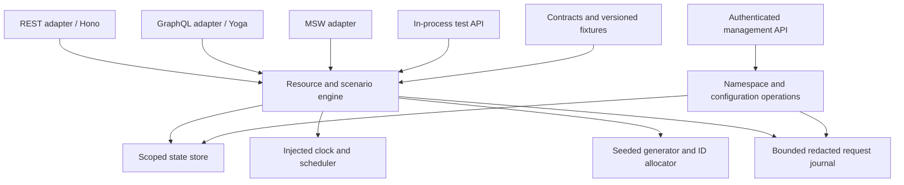

# Technical decisions and implementation constraints

Planning status: proposed architecture, researched **October 15, 2026**. This repository currently has draft documents, not an implemented application or dependency manifest/lockfile. Versions below are researched candidates, not installed or tested dependencies. Product scope, API behavior and milestones live in [PROJECT-PLAN.md](PROJECT-PLAN.md); the scenario catalog is [FRONTEND-TEST-SCENARIOS.md](FRONTEND-TEST-SCENARIOS.md).

## 1. Reference runtime and framework

Build a **portable TypeScript engine with Node.js LTS as the reference server runtime**. Distribute a CLI and Docker image. Add a Cloudflare Workers adapter for the bounded public demo when its measured behavior meets the release gates. A browser/MSW adapter is a first-class M1b delivery target because reproducible component and integration tests are central to this project.

Choose **Hono's stable release line** for HTTP routing and Web-standard Request/Response integration. Keep framework types out of the engine. Hono supports several runtimes, but transport cancellation, WebSockets, socket faults, filesystem persistence and deployment limits still require adapter-specific work. Runtime portability is a testable capability, not a promise that every feature works everywhere. [Hono documentation](https://hono.dev/docs/)

Fastify is the strongest alternative if the project becomes exclusively Node-based: it has a mature Node ecosystem and an explicit support policy. It does not justify maintaining a second HTTP stack now. Use it only if an M0 experiment identifies a material requirement Hono cannot satisfy. [Fastify support policy](https://fastify.dev/docs/latest/Reference/LTS/)

Do not support Bun, Deno, Lambda and Workers simultaneously at launch. Contributors may run compatible environments, but “supported” means documented installation, capability declarations and passing release checks. Docker is a packaging format for the Node runtime, not another execution engine.

## 2. Candidate stack and compatibility gate

Use supported stable releases, review advisories, pin the package manager and commit the lockfile during implementation. Recheck the following snapshot before installation; a newer major or prerelease alone is not a reason to adopt it. Rows marked **pinned** were installed with exact versions in M0 step 1 on 2026-10-15; the others remain candidates.

| Area | Verified candidate | Decision and primary evidence |
|---|---|---|
| Runtime | Node **24.22.0 LTS**; minimum **22.13.0** | Reference baseline is 24. Node 26.12.0 is Current in the checked release table; Node 20 is EOL. **Pinned** as `engines.node >=22.13.0`: Vitest 5 and MSW 3 declare `>=22.12`, and Faker 10.6.0, which generates the fixtures and runs in the drift test, declares `^22.13.0`; CI tests 22.13.0 and 24. [Node releases](https://nodejs.org/en/about/previous-releases) |
| Language | TypeScript **6.0.3** | **Pinned**; the newest 6.x release, published 2026-04-16. Baseline for M0–M1: the last tsc-based major, with the mature compiler API that declaration and codegen tooling consume. Strict mode, explicit public types, separate typechecking from bundling. TypeScript 7.0.2 is evaluated in M0 and adopted only when the whole chain passes. [TypeScript 7 announcement](https://devblogs.microsoft.com/typescript/announcing-typescript-7-0/) |
| HTTP | Hono **4.13.13**; `@hono/node-server` **2.1.5** | **Pinned**. The Node adapter runs with `overrideGlobalObjects: false` so in-process tests and interceptors keep Node's own `Request` and `Response`. Hono's `bodyLimit` middleware is not used: with this adapter it re-wraps bodiless `DELETE`/`OPTIONS` and chunked requests with `new Request(...)`, which throws and returns 500, so the server reads bodies itself with a byte limit; Hono 5.0.0-rc.1 was prerelease when checked. Match adapters and documentation to the chosen major. [Stable release](https://github.com/honojs/hono/releases/tag/v4.13.13), [release stream](https://github.com/honojs/hono/releases) |
| Node alternative | Fastify **5.12.7** | Evaluated alternative, not an additional dependency. Version 6 was still alpha. [Releases](https://github.com/fastify/fastify/releases) |
| GraphQL | GraphQL Yoga **5.24.5** | Add in M2, using the shared resource engine. Select compatible GraphQL.js and codegen versions then. [Releases](https://github.com/graphql-hive/graphql-yoga/releases) |
| Built-in validation | Zod **4.6.7** | **Pinned**. Author JSON-compatible built-in contracts once; generate schema artifacts. [Releases](https://github.com/colinhacks/zod/releases) |
| Test runner | Vitest **5.0.4** | **Pinned**; 5.0.5 was published on the day of installation and skipped. Vite 8.3.4 is an explicit dev dependency so the Vitest config can extend Vite's default resolve conditions. Engine, adapter and integration suites. Current guide requires Node >=22.12 and Vite >=6.4. [Releases](https://github.com/vitest-dev/vitest/releases), [requirements](https://vitest.dev/guide/) |
| Mock integration | MSW **3.0.3** | **Pinned** as an exact dev dependency of `@loadstate/msw`, with `^3.0.3` as its peer dependency so a consumer's own MSW instance intercepts requests. Browser/Node interception adapter, not a replacement server implementation. [Releases](https://github.com/mswjs/msw/releases), [purpose](https://mswjs.io/docs/) |
| Browser testing | Playwright **1.64.1** | Real browser/network checks; pin matching browser artifacts in CI. [Releases](https://github.com/microsoft/playwright/releases) |
| Package manager | pnpm **12.11.2** | **Pinned** through `packageManager`. On 2026-10-15 it carried both the `latest` and `latest-12` npm tags; 12.13.0, recorded here earlier, is published but sits behind the `next-12` tag. Workspace tooling and reproducible lockfile. [Releases](https://github.com/pnpm/pnpm/releases), [installation](https://pnpm.io/installation) |
| Playground | React **19.3**, Vite **8.3.4** | Static application; no server rendering framework is required for the playground. [React versions](https://react.dev/versions), [Vite releases](https://github.com/vitejs/vite/releases) |
| Lint and format | Biome **2.5.15** | **Pinned** as the single lint and format tool. It does not consume the TypeScript compiler API, so the TypeScript 7 experiment does not depend on it. [Releases](https://github.com/biomejs/biome/releases) |
| CI | `actions/checkout` v7.0.1, `pnpm/action-setup` v6.1.0, `actions/setup-node` v7.1.0 | **Pinned** to full commit SHAs in `.github/workflows/ci.yml`, with read-only `contents` permission. |

TypeScript 7's announcement documents a transition: it initially has no programmatic compiler API, and tools such as typed lint integrations may need the documented TypeScript 6 compatibility package. That is why the baseline stays on the 6 line. M0 runs the same typechecking, linting, declaration emission and code generation chain against TypeScript 7 as an experiment and adopts it only if everything passes. Do not conceal incompatibility with disabled checks, broad casts or suppressed peer errors. [TypeScript compatibility guidance](https://devblogs.microsoft.com/typescript/announcing-typescript-7-0/)

M0 also verifies package exports in a clean consumer, browser bundling without Node polyfills, Hono/Node interoperability, MSW interception and Windows behavior; the results are below. Yoga interoperability, stream cancellation and Docker startup move to the milestones that introduce GraphQL (M2), streams (M2) and the Docker image (M1b). Biome was selected in M0 step 1 as the one formatter and linter.

### M0 compatibility results

Checked 2026-10-15 on Windows 11 with Node 22.14.0 and pnpm 12.11.2. CI repeats the automated checks on Linux and Windows once the repository is pushed.

| Check | Result | Evidence |
|---|---|---|
| Shared engine across adapters | Pass | `packages/msw/test/parity.test.ts`: one 14-step scenario gives identical statuses, bodies and headers in-process, over Node HTTP and through MSW 3 |
| Packages in a clean consumer | Pass | `pnpm smoke:pack`: exact tarball contents, install into a fresh project outside the workspace, HTTP and MSW create-and-read with plain Node, TypeScript consumer compiles against shipped declarations |
| Browser bundling without Node polyfills | Pass | `packages/msw/test/browser-bundle.test.ts`: Vite bundles the MSW adapter with core from source; the only external import is `msw`; a deliberately added `node:fs` import makes the test fail |
| Workers entry, locally | Pass | `pnpm smoke:worker`: Wrangler 4.151.0 runs `src/worker.ts` on local workerd and answers health, list, stateless create, bodiless DELETE 405 and chunked 413. CPU and memory limits need a real deployment, which needs the owner's authorization and Cloudflare account. |
| Workers entry, deployed | Pass | Deployed 2026-10-15 with the owner's authorization to https://loadstate.veliksergey.workers.dev on the Workers Free plan (version `c1062978-f0cc-4982-8ab3-7ab0fa608104`; upload 845 KiB, 139 KiB gzip; startup 18 ms). 14 live checks passed: health, readiness, list, full list, read, stateless create, 404 after create, 422, 400, 405 with `Allow`, bodiless HEAD, unknown path, and 413 for chunked and declared oversized bodies. `wrangler tail` measured CPU per request at median 1 ms and maximum 9 ms against the Free plan's 10 ms limit; the 9 ms request was `/readyz`, probably the first request on a fresh isolate, because Hono builds its router lazily (an inference from 14 samples). Measure more requests in M1a before adding routes, and if first requests approach the limit, try a router without a build step. |
| TypeScript 7.0.2 | Pass, not adopted | `pnpm dlx --package=typescript@7.0.2 tsc -p packages/<name>/tsconfig.json` and `tsconfig.build.json` exit 0 for core, server and msw. Emitted JavaScript is identical; declarations differ only in property order inside `users.d.ts`. Typecheck time fell from about 3.4 s to 1.7 s including `dlx` startup. TypeScript stays at 6.0.3 until the OpenAPI generator chosen in M1a passes the same check. |
| Schema and OpenAPI generation | Pass | `packages/core/test/openapi.test.ts` with `@hyperjump/json-schema` 1.18.0: the generated 3.1.2 and 3.2.1 documents validate against the official `schema-base` meta-schemas, and a document missing `info` or with an invalid schema `type` is rejected. Engine responses for every documented status validate against the document's own response schemas. 40 samples, 28 valid and 12 invalid, get the same verdict from Zod and from the generated JSON Schema, including a timestamp with an offset, which both reject. |
| Hono `bodyLimit` with the Node adapter | Fail, replaced | Bodiless `DELETE`/`OPTIONS` and chunked requests returned 500; `readBody` in `packages/server/src/app.ts` replaces it. |
| Windows path length | Constraint | Paths over 260 characters break pnpm's task state and workerd's binary. The smoke checks use `os.tmpdir()`; very deep checkouts on Windows need long paths enabled. |

The two pnpm install scripts in the tree, esbuild's and workerd's, are denied in `allowBuilds`: both only download a binary that the platform package already ships, and the Worker smoke check passes without them.

## 3. Engine boundaries

The engine accepts normalized operations and returns data plus a response/effect plan. Adapters translate transport inputs and implement effects such as delays, serialization and streaming. Validation, resource querying, mutation rules and scenario selection are shared. HTTP sockets, environment bindings, files, secrets and browser service-worker lifecycle stay outside the engine.

Use small concrete interfaces for existing needs: clock, scheduler, store and journal. Avoid a general plugin system, dependency-injection container or universal database abstraction. The MSW adapter imports the portable engine and selected fixtures, not the CLI, admin server, filesystem adapter or every example dependency.

Every adapter declares supported capabilities. Unsupported transport operations return a useful configuration error instead of silently approximating a socket reset with HTTP 500. Published behavior must distinguish pure engine equivalence from observable browser/network fidelity.

## 4. Deterministic state and time

M1b includes isolated, in-memory state for local development and tests. A test gets its own engine instance or namespace; there is no process-global mutable fixture array. Public demonstration writes remain stateless and clearly labelled from M1a. A database is unnecessary for either release. The injected business clock, journal and HTTP control API described below are M2 deliverables; M1b ships run creation, reset and sequences with a simple data revision counter.

A reproducible run records **fixture version, seed, fixed reference time, locale/timezone, scenario revision and explicit step/request key**. Build-time Faker output is committed and reviewed. Faker version upgrades and relative-date generation can change fixtures even with a fixed seed, so generation records dependency versions and a reference clock. [Faker reproducibility guidance](https://fakerjs.dev/guide/usage.html#reproducible-results)

Prefer explicit sequences and named steps for assertions. Random behavior is opt-in exploration. Parallel requests must not consume one shared random stream whose results depend on arrival order; derive independent streams from stable request/actor identifiers. Sequence advancement and mutations are atomic within a namespace. Identical concurrent requests without explicit distinguishing keys have documented arrival-order behavior, not an impossible scheduling guarantee.

Reset restores data, ID allocation, logical time, scenario position and journal together. Define what happens to in-flight requests: use namespace generations and cancel or reject effects targeting an old generation. Snapshot/restore needs a versioned format and the same consistency boundary. Stream timers must observe cancellation and release resources.

Name storage modes honestly: memory state lasts until reset/restart; persistence means surviving restart. Optional SQLite durability can follow demonstrated demand. Keep its migration/versioning and file locking concerns in a Node-only adapter. A single memory/SQLite instance is not automatically a horizontally scalable service.

Hosted mutable sandboxes are M3, after isolation and operating budgets are proven. Cloudflare KV is eventually consistent and unsuitable for exact sequence counters or transactional read-after-write behavior. A Durable Object per bounded sandbox is a candidate adapter, not a requirement imposed on local users. [KV consistency](https://developers.cloudflare.com/kv/concepts/how-kv-works/)

## 5. Schemas and package contracts

Use Zod for built-in resource and configuration contracts, with separate read/create/replace/patch shapes. Represent dates and large identifiers as documented JSON values rather than relying on JavaScript-only types. Derive TypeScript types and JSON Schema artifacts; keep cross-record business checks explicit. Zod documents that transforms, dates, custom schemas and other constructs do not all have a faithful JSON Schema equivalent. Never export those as unrestricted schemas to make generation pass. [Zod conversion limits](https://zod.dev/json-schema)

Generate REST documentation from the same route metadata and contract definitions. **OpenAPI 3.2.1 is the current published specification checked here**, dated September 10, 2026. Try that target in M0; use 3.1.x only if the selected generator, documentation UI or client tooling requires it, and record the compatibility reason. Do not call 3.1 the newest standard. [OpenAPI 3.2.1](https://spec.openapis.org/oas/v3.2.1.html)

**M0 decision, 2026-10-15:** `createOpenApiDocument` in `packages/core` generates the document from the Zod contracts through `z.toJSONSchema`, for both 3.1.2 and 3.2.1, the latest patches listed at [spec.openapis.org/oas](https://spec.openapis.org/oas/). Loadstate uses no 3.2-only feature such as `QUERY` or `additionalOperations`, so both documents carry identical content. M1a serves 3.1.2 as the default `/openapi.json` and 3.2.1 alongside it, because the documentation, validation and client tools do not yet read 3.2 reliably. [API Evangelist's survey of 2026-10-09](https://apievangelist.com/2026/10/09/a-year-after-openapi-3-2-most-api-tooling-cannot-read-it/) found that swagger-parser (JavaScript and Java), Spectral, ReadMe and Fern reject 3.2 documents, that openapi-typescript and hey-api omit 3.2-only operations, and that Swagger UI and Scalar accept 3.2. Revisit when M1a chooses its documentation UI and client generator and tests them against the served documents. **M1a step 6, 2026-10-19:** `/docs` uses Scalar `@scalar/api-reference` 1.72.4 from jsDelivr, pinned with a SHA-384 integrity hash and loaded through its `data-url` setup so the page has no inline script; 1.72.4 was the newest release older than two weeks (1.75.0 was three days old). The served documents are generated at development time and committed, because a cold generation takes about 29 ms against the Workers free plan's 10 ms CPU budget.

GraphQL SDL remains an explicit public contract mapped to shared domain operations. It cannot be mechanically treated as REST JSON Schema: nullability, connections, resolver errors and selected fields have different semantics. Generate resolver/client types from SDL and verify common domain results across transports.

When arbitrary schema imports arrive in M3, introduce Ajv only if required. Define supported JSON Schema/OpenAPI dialects, reference resolution and rejection rules. Ajv's 2020-12 support uses a distinct validator class and cannot mix previous drafts in the same instance. Imported remote references, expensive expressions and recursive schemas require strict bounds. [Ajv dialect support](https://ajv.js.org/json-schema.html)

Use a small pnpm workspace: portable engine/contracts; Node server/CLI; test adapters; static site and examples. These are source ownership boundaries, not a demand to publish many packages. A primary npm package can expose narrow subpaths for types, fixtures and MSW. Publish ESM and declarations first; add CommonJS only for a verified consumer need. Keep optional GraphQL, browser and persistence dependencies out of entry points that do not need them.

Version API behavior, fixture packs and scenario/snapshot formats deliberately. URLs in generated fixtures must resolve through configured base URLs, not hard-coded public hosts. Package consumers must work without contacting the hosted service.

## 6. Security boundaries

The application has two distinct authorities: **simulated application identity** for testing login/roles, and **real management authorization** for reset, configuration, logs and namespace ownership. Demo JWTs, role headers and scenario controls never grant management access. Controls cannot bypass infrastructure rate limits, resource caps or authorization.

Bind local management to loopback by default; require a generated management credential and validate Host/Origin for browser access. Disable public management routes in the anonymous demo. Remote self-hosted management requires explicit enablement, TLS and real credentials. CORS configuration is not authorization. Bearer tokens belong in headers, never shareable scenario URLs or logs.

A client-chosen run ID only selects a namespace. Remote private runs, whether self-hosted or the optional M3 hosted sandboxes, require server-issued unguessable data credentials, ownership checks on every read and mutation, expiration, budgets and cleanup; management credentials remain separate and more privileged. Prevent cross-namespace cache and state leakage.

Reserved header names, so a resource or scenario can never shadow them: `Authorization` on data routes carries the simulated application's token; a product-prefixed run-admission header, named once the product name is final, carries real private-run admission; the control surface uses its own management credential. Admission precedes scenario handling, and redaction covers all three carriers. The full remote-run design, including a same-origin or cookie path for native image and EventSource clients, is written when private remote runs are scheduled; M1 needs only the loopback-bound local control surface above.

Bound request bodies, response sizes, expansion depth, GraphQL complexity/aliases, journal retention, pending timers and concurrent streams. Validate image dimensions and escape SVG text; disallow scripts, external references and executable templates. Echo/journal output redacts credentials and cookies and avoids recording bodies by default. Real credentials and personal production data are unnecessary for this product.

Public proxying, arbitrary webhook delivery, remote schema resolution and user-supplied executable handlers are excluded from the anonymous service. Optional local integrations require explicit targets and SSRF protections; imported paths cannot escape their configured directory. Trusted local extension code runs with the user's privileges and must be documented accordingly.

## 7. Hosting, limits and cost

| Deployment | Best fit | Tradeoffs and decision |
|---|---|---|
| Local Node CLI | Development and deterministic tests | Full reference capability, loopback defaults, isolated state; no public network dependency. |
| Docker on a small server | Portable self-hosting and full public service | Predictable capacity, durable volumes and reverse-proxy control; operator manages updates, backups, concurrency and bandwidth. |
| Workers plus static assets | Bounded public demo | Global distribution and low entry cost; verify CPU, startup, streaming and state constraints. Optional adapter, not the engine's design boundary. |
| AWS Lambda function URL behind CloudFront | Alternative public demo if AWS experience is a portfolio goal | Checked 2026-10-15: always-free tiers (1M requests and 400,000 GB-seconds on Lambda; 10M requests and 1 TB on CloudFront pay-as-you-go) cover the target traffic for about $0–5/month at 3–10M requests. Delays bill as wall time, so a delay-heavy month costs more than on Workers; there is no hard spending cap, only reserved concurrency as a throttle; new accounts start with an unpublished reduced concurrency quota. A $5–7/month Lightsail VM is the predictable choice for the stateful server. [Lambda pricing](https://aws.amazon.com/lambda/pricing/), [CloudFront pay-as-you-go](https://aws.amazon.com/cloudfront/pricing/pay-as-you-go/), [Lambda quotas](https://docs.aws.amazon.com/lambda/latest/dg/gettingstarted-limits.html), [Lightsail pricing](https://aws.amazon.com/lightsail/pricing/) |

The draft's Workers figures need correction. As checked October 15, the official limits are **100,000 free requests/day, 10 ms CPU/request, 128 MB memory per isolate and 64 MiB uncompressed Worker size**. The page states no general requests-per-second limit; the old 3 MB and 1,000/minute claims should not drive design. Memory is shared by concurrent requests in an isolate. HTTP streaming can continue while the client stays connected, but runtime replacement and disconnects still interrupt work. [Workers limits](https://developers.cloudflare.com/workers/platform/limits/)

The pricing page distinguishes static assets from dynamic Workers and Workers Caching. Static-asset requests are free under the documented model; Workers Cache hits still count as requests while avoiding Worker CPU. An application Cache API lookup inside an executing Worker is not the same thing. The paid subscription currently starts at $5/month with usage charges beyond allowances; storage and related services have their own meters. Recheck before deployment. [Workers pricing](https://developers.cloudflare.com/workers/platform/pricing/)

Keep public simulation responses uncached by default. Immutable normal assets may be cached; requests involving sequences, mutations, delays, intentional errors or authentication must not accidentally bypass the engine. Client HTTP-cache experiments get explicit policies isolated from infrastructure caching.

Capacity estimates must include request count, CPU, live streams, memory, upload/download bytes, storage, logs and domain renewal. A useful stream estimate is arrival rate multiplied by average stream duration. Do not promise $0-12/year or unlimited use. Set application caps, operator budgets and alerts; alerts are not hard spend ceilings. Cloudflare's rate-limiting binding is permissive/eventually consistent, so it is abuse mitigation rather than exact accounting. [Rate-limit accuracy](https://developers.cloudflare.com/workers/runtime-apis/bindings/rate-limit/)

## 8. Technical release gates

M0 resolves compatibility, packaging and hosting uncertainties with a small experiment and puts a health endpoint on a public URL. M1a delivers the deployed stateless REST demo and the local `npx` server. M1b delivers local isolated state, reset, deterministic sequences and MSW. M2 adds the business clock, journal and control API, then GraphQL, simulated auth, files and streams for stable v1. M3 evaluates advanced realtime, imports and optional hosted sandboxes. Follow the detailed acceptance criteria in [PROJECT-PLAN.md](PROJECT-PLAN.md).

Engine tests prove deterministic behavior; adapter tests prove translation; actual HTTP/browser tests prove transport behavior. In-process request helpers cannot establish CORS, cookie restrictions, proxy buffering, stream flushing or socket cancellation. Run targeted network/browser checks for those features and report unsupported capabilities explicitly. [Playwright network testing](https://playwright.dev/docs/network)

Before a supported release, verify clean package installation, offline fixtures, namespace cleanup, abort resource cleanup, security boundaries, artifact size and documented runtime budgets. Publish/deploy workflows are planned deliverables; this document does not authorize running them. The highest technical risks are concurrent state determinism, transport fidelity and long-term contract stability, so those receive effort before additional datasets or hosting providers.
